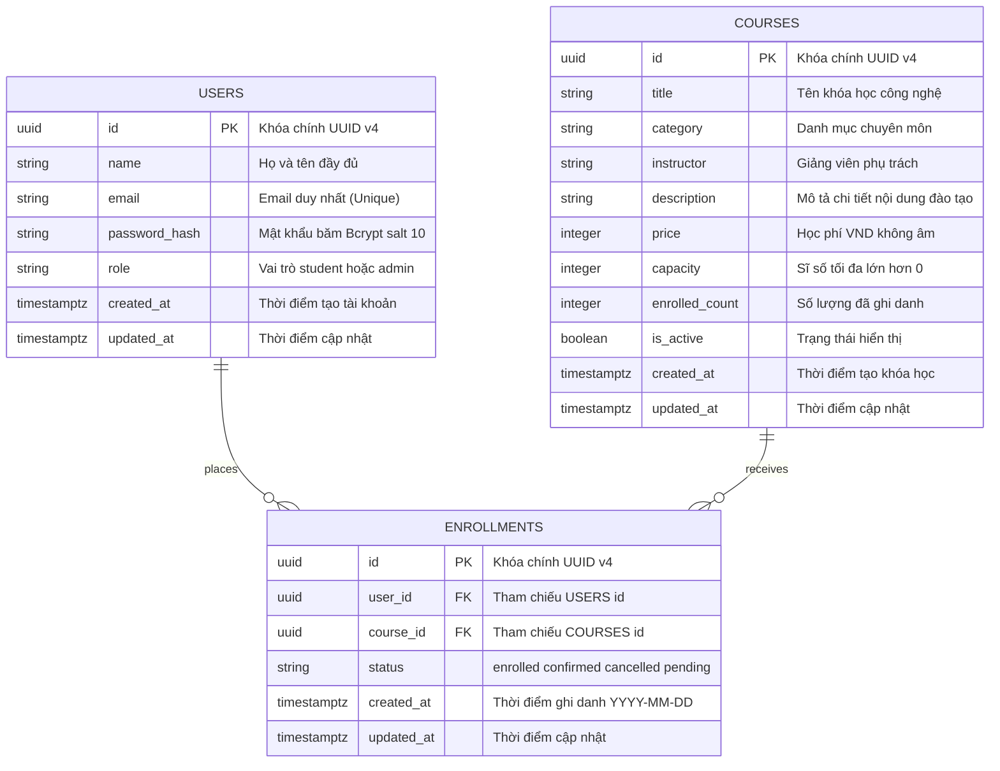

# 📊 Entity-Relationship Diagram (ERD) & Database Specification
## PKS Course & Enrollment Portal

> **Mã tài liệu:** `docs/ERD.md`  
> **Tuân thủ:** `ND_PV_FULLSTACK.pdf §4`, `docs/REQUIREMENTS.md §4`, `specs/009-audit-remediation/spec.md GAP-06`  
> **Hệ quản trị CSDL:** PostgreSQL 15+ (với Prisma ORM v5.x)  
> **Múi giờ chuẩn:** `Asia/Ho_Chi_Minh` (UTC+7)  
> **Định dạng thời gian:** ISO 8601 / `YYYY-MM-DD`  

---

## 1. Tổng quan Kiến trúc Dữ liệu (Architecture Overview)

Cơ sở dữ liệu của **PKS Course & Enrollment Portal** được thiết kế chuẩn hóa theo dạng chuẩn 3NF (Third Normal Form), đảm bảo tính toàn vẹn dữ liệu tối đa, triệt tiêu dư thừa dữ liệu (redundancy) và thiết lập các rào chắn vật lý (Physical Invariants) ngăn chặn các lỗi tranh chấp ghi danh đồng thời (Race Condition), tấn công IDOR và rò rỉ phân quyền RBAC.

Hệ thống bao gồm **3 Thực thể cốt lõi (Entities)**:
1. `users`: Quản lý tài khoản người dùng, phân quyền RBAC (`student` vs `admin`), mật khẩu băm Bcrypt an toàn.
2. `courses`: Quản lý danh mục khóa học đào tạo, sức chứa (`capacity`), sĩ số thực tế (`enrolled_count`), học phí và trạng thái hiển thị (`is_active`).
3. `enrollments`: Bản ghi liên kết ghi danh giữa Học viên và Khóa học, lưu vết thời điểm đăng ký, trạng thái duyệt (`status`), bảo vệ toàn vẹn bằng chỉ mục duy nhất `(user_id, course_id)`.

---

## 2. Sơ đồ Quan hệ Thực thể (Mermaid Entity-Relationship Diagram)



---

## 3. Từ điển Dữ liệu Chi tiết (Data Dictionary)

### 3.1. Bảng `users` (Quản lý Người dùng & Xác thực)
Bảng lưu trữ thông tin nhận dạng, thông tin đăng nhập và phân quyền của toàn bộ người dùng trong hệ thống (cả Học viên và Quản trị viên).

| Tên Cột (Column) | Kiểu Dữ Liệu (Type) | Ràng Buộc (Constraints) | Giá Trị Mặc Định | Mô Tả & Ý Nghĩa Nghiệp Vụ |
| :--- | :--- | :--- | :--- | :--- |
| `id` | `VARCHAR(36)` / `UUID` | `PRIMARY KEY` | `uuid()` | Khóa chính định danh duy nhất của người dùng. |
| `name` | `VARCHAR(255)` | `NOT NULL` | *Không có* | Họ và tên người dùng (tối thiểu 2 ký tự, hỗ trợ Unicode tiếng Việt đầy đủ). |
| `email` | `VARCHAR(255)` | `UNIQUE`, `NOT NULL`, `INDEX` | *Không có* | Email đăng nhập duy nhất toàn hệ thống, tự động chuẩn hóa lowercase trước khi lưu. |
| `password_hash`| `VARCHAR(255)` | `NOT NULL` | *Không có* | Chuỗi băm mật khẩu bảo mật sinh bởi thuật toán `bcrypt` với cost factor `salt >= 10`. |
| `role` | `ENUM('student', 'admin')` | `NOT NULL` | `'student'` | Phân quyền vai trò người dùng trong hệ thống (`student` = Học viên, `admin` = Quản trị viên). |
| `created_at` | `TIMESTAMPTZ` | `NOT NULL` | `CURRENT_TIMESTAMP` | Thời điểm tạo tài khoản, múi giờ `Asia/Ho_Chi_Minh`. |
| `updated_at` | `TIMESTAMPTZ` | `NOT NULL` | `CURRENT_TIMESTAMP` | Thời điểm bản ghi được cập nhật lần cuối (tự động cập nhật qua Prisma `@updatedAt`). |

---

### 3.2. Bảng `courses` (Danh mục Khóa học)
Bảng lưu trữ toàn bộ các khóa học đào tạo công nghệ được cung cấp bởi PKS Education & Technology.

| Tên Cột (Column) | Kiểu Dữ Liệu (Type) | Ràng Buộc (Constraints) | Giá Trị Mặc Định | Mô Tả & Ý Nghĩa Nghiệp Vụ |
| :--- | :--- | :--- | :--- | :--- |
| `id` | `VARCHAR(36)` / `UUID` | `PRIMARY KEY` | `uuid()` | Khóa chính định danh duy nhất của khóa học. |
| `title` | `VARCHAR(255)` | `NOT NULL` | *Không có* | Tên đầy đủ của khóa học (Ví dụ: *"Lập Trình Web Fullstack Chuyên Nghiệp"*). |
| `category` | `VARCHAR(100)` | `NOT NULL`, `INDEX` | *Không có* | Nhóm chuyên môn đào tạo (Frontend, Backend, Fullstack, DevOps, Tin Học Văn Phòng). |
| `instructor` | `VARCHAR(255)` | `NOT NULL` | *Không có* | Họ tên chuyên gia/giảng viên giảng dạy khóa học. |
| `description` | `TEXT` | `NOT NULL` | *Không có* | Nội dung mô tả chi tiết chương trình học và mục tiêu đầu ra. |
| `price` | `INTEGER` | `NOT NULL`, `CHECK(price >= 0)` | `0` | Học phí tính theo đơn vị Đồng Việt Nam (VND), hiển thị chuẩn `\u00A0₫`. |
| `capacity` | `INTEGER` | `NOT NULL`, `CHECK(capacity > 0)` | *Không có* | Sĩ số tối đa của khóa học. Phải luôn thỏa mãn `capacity >= enrolled_count`. |
| `enrolled_count`| `INTEGER` | `NOT NULL`, `CHECK(enrolled_count >= 0)` | `0` | Số lượng học viên hiện đang ghi danh thực tế (tính các trạng thái `enrolled` và `confirmed`). |
| `is_active` | `BOOLEAN` | `NOT NULL`, `INDEX` | `true` | Trạng thái hiển thị (`true`: Mở ghi danh, `false`: Ẩn/Lưu nháp/Xóa mềm). |
| `created_at` | `TIMESTAMPTZ` | `NOT NULL` | `CURRENT_TIMESTAMP` | Thời điểm tạo khóa học. |
| `updated_at` | `TIMESTAMPTZ` | `NOT NULL` | `CURRENT_TIMESTAMP` | Thời điểm cập nhật thông tin khóa học gần nhất. |

---

### 3.3. Bảng `enrollments` (Bản ghi Ghi danh Học viên)
Bảng trung gian thiết lập mối quan hệ N - N giữa `users` và `courses`, lưu trữ lịch sử và trạng thái xử lý từng lượt đăng ký học.

| Tên Cột (Column) | Kiểu Dữ Liệu (Type) | Ràng Buộc (Constraints) | Giá Trị Mặc Định | Mô Tả & Ý Nghĩa Nghiệp Vụ |
| :--- | :--- | :--- | :--- | :--- |
| `id` | `VARCHAR(36)` / `UUID` | `PRIMARY KEY` | `uuid()` | Khóa chính định danh duy nhất của bản ghi ghi danh. |
| `user_id` | `VARCHAR(36)` / `UUID` | `FOREIGN KEY`, `NOT NULL`, `INDEX` | *Không có* | Khóa ngoại trỏ đến `users(id)` với hành vi `onDelete: Restrict`. |
| `course_id` | `VARCHAR(36)` / `UUID` | `FOREIGN KEY`, `NOT NULL`, `INDEX` | *Không có* | Khóa ngoại trỏ đến `courses(id)` với hành vi `onDelete: Restrict`. |
| `status` | `ENUM('enrolled', 'confirmed', 'cancelled', 'pending')` | `NOT NULL` | `'enrolled'` | Trạng thái hiện tại của lượt ghi danh (`enrolled`: mới đăng ký, `confirmed`: đã xác nhận, `cancelled`: đã hủy, `pending`: chờ duyệt). |
| `created_at` | `TIMESTAMPTZ` | `NOT NULL` | `CURRENT_TIMESTAMP` | Thời điểm ghi danh thành công, định dạng hiển thị `YYYY-MM-DD` tại Việt Nam. |
| `updated_at` | `TIMESTAMPTZ` | `NOT NULL` | `CURRENT_TIMESTAMP` | Thời điểm cập nhật trạng thái ghi danh gần nhất. |

---

## 4. Đặc tả Ràng buộc & Cơ chế Toàn vẹn (Relational Integrity & Rationale)

### 4.1. Ràng buộc `onDelete: Restrict` (Chống Xóa Xuyên Thấu Dữ Liệu)
Trong file Prisma Schema (`schema.prisma`):
```prisma
user   User   @relation(fields: [user_id], references: [id], onDelete: Restrict)
course Course @relation(fields: [course_id], references: [id], onDelete: Restrict)
```

#### 💡 Rationale & Ý Nghĩa Thực Tiễn:
1. **Bảo vệ Lịch sử Học tập & Tài chính:**
   - Nếu áp dụng `onDelete: Cascade`, khi một tài khoản User bị xóa, toàn bộ lịch sử tham gia khóa học của học viên đó sẽ lập tức bị xóa sổ vật lý khỏi hệ thống. Điều này vi phạm nguyên tắc lưu vết kiểm toán (Audit Trail) và quy chuẩn đối soát kế toán doanh nghiệp.
   - Khi áp dụng `onDelete: Restrict`, hệ CSDL sẽ chủ động **chặn đứng** mọi thao tác xóa người dùng nếu người đó đang có bản ghi trong bảng `enrollments`.
2. **Bảo vệ Khóa học Đang có Học viên (Course Deletion Guard):**
   - Một khóa học đã có học viên đăng ký (`enrollments` tồn tại) **tuyệt đối không được phép xóa cứng** (`DELETE FROM courses WHERE id = ...`).
   - Ràng buộc `Restrict` đảm bảo nếu Quản trị viên muốn ngừng tuyển sinh một khóa học, họ **bắt buộc phải dùng cơ chế Xóa Mềm (Soft Delete / Deactivate)** thông qua trường `is_active = false`. Điều này giữ nguyên quyền lợi truy cập lịch sử của các học viên đã ghi danh.

---

### 4.2. Ràng buộc Khóa Phức Hợp Duy Nhất (Compound Unique Constraint)
Trong bảng `enrollments`:
```prisma
@@unique([user_id, course_id])
```

#### 💡 Rationale & Ý Nghĩa Thực Tiễn:
1. **Triệt tiêu Race Condition & Double Enrollment ở Tầng Vật Lý:**
   - Dù ở tầng giao diện người dùng có hiện tượng nhấp đúp (Double-click) hoặc nhiều request đồng thời gửi tới API ghi danh, chỉ mục duy nhất `(user_id, course_id)` ở tầng CSDL sẽ kích hoạt lỗi `P2002 Unique Constraint Violation` ngay lập tức đối với request thứ hai.
   - Backend bắt lỗi này và chuyển hóa thành mã lỗi HTTP `409 Conflict` với mã thông điệp `ALREADY_ENROLLED` theo đúng hợp đồng giao tiếp chuẩn RESTful.

---

### 4.3. Bất Biến Sức Chứa & Cập Nhật Nguyên Tử (Atomic Seat Allocation Invariant)

1. **Ghi danh Suất Cuối (Race Condition Prevention):**
   - Tránh hiện tượng Overbooking khi nhiều học viên cùng tranh giành suất học cuối cùng (`enrolled_count = capacity - 1`).
   - Câu lệnh cập nhật nguyên tử có điều kiện:
     ```sql
     UPDATE "courses"
     SET "enrolled_count" = "enrolled_count" + 1
     WHERE "id" = :courseId AND "enrolled_count" < "capacity";
     ```
   - Nếu câu lệnh tác động vào 0 dòng (Rows affected = 0), hệ thống nhận diện khóa học đã đầy và trả về HTTP `400 Bad Request` hoặc `409 Conflict` (`CAPACITY_FULL`).

2. **Hủy Ghi Danh Hoàn Suất Học (Atomic Seat Release):**
   - Khi học viên tự hủy ghi danh (`POST /api/student/enrollments/:id/cancel`), hệ thống chuyển `status` sang `'cancelled'` và trả lại suất học trong cùng một Transaction:
     ```sql
     UPDATE "courses"
     SET "enrolled_count" = GREATEST("enrolled_count" - 1, 0)
     WHERE "id" = :courseId;
     ```
   - Hàm `GREATEST(..., 0)` đảm bảo trường `enrolled_count` không bao giờ rơi vào giá trị âm trong mọi tình huống bất thường.

3. **Bất Biến Sĩ Số Khi Quản Trị Viên Giảm Capacity (Admin Invariant Guard):**
   - Khi Admin điều chỉnh giảm `capacity` của khóa học (`PUT /api/admin/courses/:id`), hệ thống kiểm tra logic bất biến:
     $$\text{capacity}_{\text{new}} \ge \text{enrolled\_count}_{\text{current}}$$
   - Nếu vi phạm, server từ chối cập nhật và trả về HTTP `400 Bad Request` (`INVALID_CAPACITY`).

---

## 5. Danh Mục Chỉ Mục (Indexes Optimization Strategy)

Để đảm bảo hiệu năng truy vấn dưới 10ms ngay cả khi khối lượng dữ liệu tăng cao, hệ thống triển khai các chỉ mục B-Tree chuyên biệt:

| Bảng (Table) | Tên Chỉ Mục (Index Name) | Các Cột (Columns) | Loại Index | Mục Đích Tối Ưu Hóa Truy Vấn |
| :--- | :--- | :--- | :--- | :--- |
| `users` | `users_email_key` | `email` | `UNIQUE B-Tree` | Đăng nhập, tra cứu tài khoản, kiểm tra trùng email khi đăng ký (O(1)). |
| `courses` | `courses_category_idx` | `category` | `B-Tree` | Tối ưu bộ lọc danh mục khóa học trên trang Catalog (`GET /api/courses?category=...`). |
| `courses` | `courses_is_active_idx` | `is_active` | `B-Tree` | Tối ưu việc lọc các khóa học đang mở cho học viên (`where: { is_active: true }`). |
| `enrollments` | `enrollments_user_id_course_id_key` | `user_id, course_id` | `UNIQUE B-Tree` | Chặn học viên ghi danh trùng 2 lần, kiểm tra trạng thái `is_enrolled`. |
| `enrollments` | `enrollments_user_id_idx` | `user_id` | `B-Tree` | Tối ưu trang "Khóa học của tôi" (`GET /api/student/my-courses`), bảo vệ chống IDOR. |
| `enrollments` | `enrollments_course_id_idx` | `course_id` | `B-Tree` | Tối ưu trang Admin xem danh sách học viên theo từng khóa (`GET /api/admin/courses/:id/enrollments`). |

---

## 6. Đối Chiếu Chuẩn Khớp Mã Nguồn Thực Tế (Codebase Alignment)

| Đặc Tả ERD | Khai Báo Trong Schema Prisma (`server/prisma/schema.prisma`) | Kiểm Chứng Trạng Thái |
| :--- | :--- | :---: |
| Entity `users` | `model User { ... @@map("users") }` | ✅ 100% Khớp |
| Entity `courses` | `model Course { ... @@map("courses") }` | ✅ 100% Khớp |
| Entity `enrollments` | `model Enrollment { ... @@map("enrollments") }` | ✅ 100% Khớp |
| Enum `Role` | `enum Role { student, admin }` | ✅ 100% Khớp |
| Enum `EnrollmentStatus` | `enum EnrollmentStatus { enrolled, confirmed, cancelled, pending }` | ✅ 100% Khớp |
| Ràng buộc `onDelete` | `onDelete: Restrict` trên cả `user` và `course` relation | ✅ 100% Khớp |
| Ràng buộc duy nhất | `@@unique([user_id, course_id])` | ✅ 100% Khớp |
| Chỉ mục Index | `@@index([category])`, `@@index([is_active])`, `@@index([user_id])`, `@@index([course_id])` | ✅ 100% Khớp |
