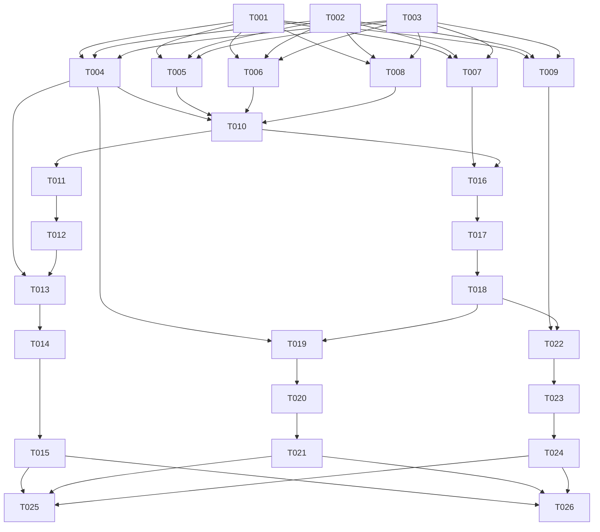

# Tasks: 001-auth-identity

**Input**: Design documents from `/specs/001-auth-identity/`  
**Prerequisites**: `spec.md`, `plan.md`  
**Target Project**: `/Users/macbookpro/Documents/Work/Prepare/PKS/pks-course-enrollment-portal`

---

## Execution Summary
- **Total Task Count**: 26
- **User Stories Covered**: US1 (Student Registration), US2 (Login & JWT), US3 (Session Hydration /me), US4 (Logout & Navigation)
- **MVP Scope**: Phase 1 through Phase 4 (US1 & US2)

---

## Phase 1: Setup & Infrastructure

**Purpose**: Initialize directory structure and routing baseline for authentication.

- [ ] T001 Create client authentication pages directory in `client/src/pages/` and services directory in `client/src/services/`
- [ ] T002 [P] Create backend authentication controller, service, schema, and route directories in `server/src/controllers/`, `server/src/services/`, `server/src/schemas/`, and `server/src/routes/`
- [ ] T003 [P] Verify environment variables template `server/.env.example` includes `JWT_SECRET`, `CLIENT_URL`, and `PORT=5001`

---

## Phase 2: Foundational Prerequisites

**Purpose**: Core types, Zod validation schemas, and cryptographic helpers required before implementing user stories.

- [ ] T004 [P] Define TypeScript shared interfaces (`User`, `AuthState`, `LoginCredentials`, `RegisterPayload`, `AuthResponse`) in `client/src/types/auth.ts`
- [ ] T005 [P] Implement Zod schemas (`registerSchema`, `loginSchema`) with email regex and string length validation in `server/src/schemas/auth.schema.ts`
- [ ] T006 Implement password hashing helper using `bcryptjs` with salt work factor $\ge 10$ and comparison helper in `server/src/utils/password.ts`
- [ ] T007 Implement JWT helper functions for signing (`algorithm: 'HS256'`, `expiresIn: '1d'`) and verification in `server/src/utils/jwt.ts`
- [ ] T008 Implement generic Zod validation middleware for Express in `server/src/middlewares/validate.middleware.ts`
- [ ] T009 Ensure JWT authentication middleware `authenticateJWT` decodes Bearer token into `req.user` or returns 401 in `server/src/middlewares/auth.middleware.ts`

---

## Phase 3: User Story 1 — Student Account Registration (Priority: P1 🎯 MVP)

**Goal**: Enable prospective students to register an account with name, email, and password, securely hashed with bcrypt salt $\ge 10$, and default role `student`.

**Independent Test**: Send `POST /api/auth/register` with valid payload, verify 201 Created response, and verify 409 Conflict when attempting to register with the same email.

### Backend Implementation (US1)
- [ ] T010 [US1] Implement `registerUser` service in `server/src/services/auth.service.ts` checking duplicate email (throws `EMAIL_ALREADY_EXISTS` 409), hashing password with `bcryptjs` salt 10, and creating User with role `student`
- [ ] T011 [US1] Implement `register` controller action returning uniform envelope `{ success: true, data: user, message }` (omitting `password_hash`) in `server/src/controllers/auth.controller.ts`
- [ ] T012 [US1] Mount `POST /register` with `validate(registerSchema)` in `server/src/routes/auth.routes.ts` and register `/api/auth` in `server/src/routes/index.ts`

### Frontend Implementation (US1)
- [ ] T013 [P] [US1] Implement `register` method calling `POST /api/auth/register` in `client/src/services/authService.ts`
- [ ] T014 [US1] Build accessible `RegisterPage` component in `client/src/pages/RegisterPage.tsx` with inputs (`input-register-name`, `input-register-email`, `input-register-password`, `input-register-confirm-password`), submit button (`btn-register-submit`), `<label htmlFor>`, mobile touch targets $\ge 44\text{px}$, and Sonner toast feedback (no alert)
- [ ] T015 [US1] Register route `/register` in `client/src/App.tsx` and link from header

---

## Phase 4: User Story 2 — User Authentication & JWT Issuance (Priority: P1 🎯 MVP)

**Goal**: Authenticate students and administrators, returning signed JWT tokens with 1-day expiration and user profile info.

**Independent Test**: Send `POST /api/auth/login` with valid credentials, verify 200 OK with token and user object, and verify 401 Unauthorized for invalid passwords.

### Backend Implementation (US2)
- [ ] T016 [US2] Implement `loginUser` service in `server/src/services/auth.service.ts` validating email existence, verifying bcrypt password hash, and generating JWT token with claims `{ id, email, role }`
- [ ] T017 [US2] Implement `login` controller action returning uniform envelope `{ success: true, data: { token, user }, message }` in `server/src/controllers/auth.controller.ts`
- [ ] T018 [US2] Mount `POST /login` with `validate(loginSchema)` in `server/src/routes/auth.routes.ts`

### Frontend Implementation (US2)
- [ ] T019 [P] [US2] Implement `login` method calling `POST /api/auth/login` in `client/src/services/authService.ts`
- [ ] T020 [US2] Build accessible `LoginPage` component in `client/src/pages/LoginPage.tsx` with inputs (`input-login-email`, `input-login-password`), submit button (`btn-login-submit`), error banner (`alert-login-error`), `returnUrl` query parameter handling, and Sonner toast
- [ ] T021 [US2] Register route `/login` in `client/src/App.tsx` and configure login redirection logic

---

## Phase 5: User Story 3 — Session Hydration & Auto-Login (`/api/auth/me`) (Priority: P2)

**Goal**: Automatically hydrate user session from `localStorage` upon page refresh and verify authenticity against backend `/api/auth/me`.

**Independent Test**: Store valid token in `localStorage`, refresh browser, verify `GET /api/auth/me` is dispatched and sets user context to authenticated.

- [ ] T022 [US3] Implement `getMe` service and controller returning authenticated user profile (excluding `password_hash`) in `server/src/controllers/auth.controller.ts` and mount `GET /me` with `authenticateJWT` in `server/src/routes/auth.routes.ts`
- [ ] T023 [US3] Implement `AuthContext` and `AuthProvider` in `client/src/contexts/AuthContext.tsx` providing `user`, `token`, `isAuthenticated`, `isLoading`, `login`, `logout`, and `updateUser` with bootstrap `GET /api/auth/me` verification

---

## Phase 6: User Story 4 — User Logout & Navigation State (Priority: P2)

**Goal**: Provide secure logout functionality across desktop and mobile, clearing tokens and returning UI to guest state.

**Independent Test**: Click logout button, verify token is purged from `localStorage`, auth context resets to null, and home page is displayed with guest header.

- [ ] T024 [US4] Update `client/src/components/Header.tsx` to consume `useAuth()`: display guest links (`btn-header-login`, `btn-header-register`) when unauthenticated, and user greeting (`badge-user-name`), role badge (`badge-user-role`), profile link (`link-header-profile`), and logout button (`btn-header-logout`, `btn-mobile-logout`) when authenticated

---

## Phase 7: Polish & Cross-Cutting Concerns

**Purpose**: Accessibility audit, mobile touch verification, theme contrast checks, and regression tests.

- [ ] T025 [P] Audit form accessibility, ensuring all `<input>` elements have matching `<label htmlFor>`, `aria-describedby` for error text, and keyboard tab order across `client/src/pages/LoginPage.tsx` and `client/src/pages/RegisterPage.tsx`
- [ ] T026 [P] Verify mobile touch ergonomics (tap target $\ge 44\text{px}$, input font size $\ge 16\text{px}$) and dual theme contrast (Deep Emerald vs Deep Amber role badges) on 375px mobile viewport in `client/src/pages/LoginPage.tsx` and `client/src/pages/RegisterPage.tsx`

---

## Dependencies & Execution Graph

