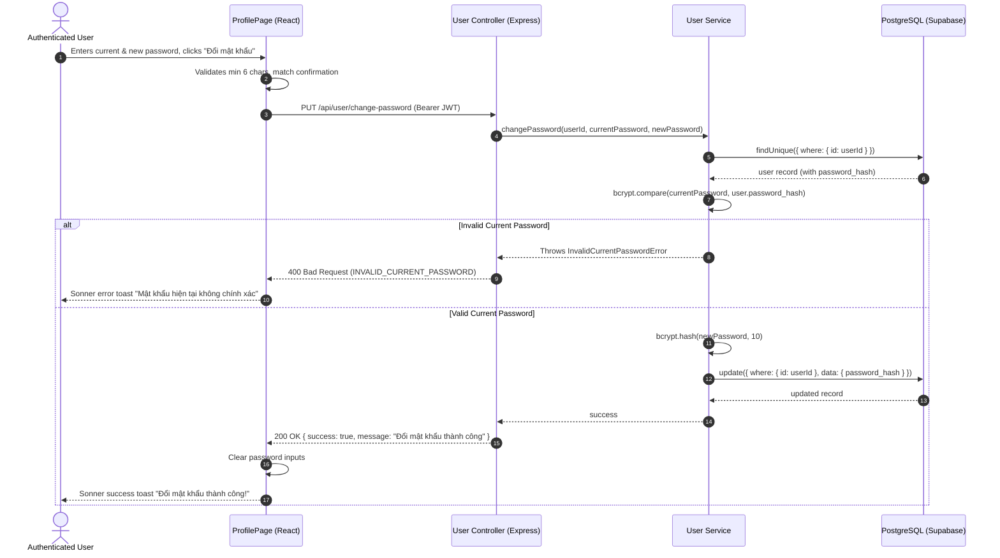

# Implementation Plan: 008-user-profile

**Branch**: `008-user-profile` | **Date**: 2026-11-05 | **Spec**: [Feature Specification: 008-user-profile](./spec.md)  
**Target Project**: `/Users/macbookpro/Documents/Work/Prepare/PKS/pks-course-enrollment-portal`

---

## 1. Summary

This plan outlines the architecture, database projections, RESTful interface contracts, security invariants, and testing strategy for the **008-user-profile** feature. It delivers:
1. Protected user profile inspection API (`GET /api/user/profile`) returning public user metadata and formatted registration date.
2. Protected display name update API (`PUT /api/user/profile`) with Zod validation, sanitization, and immutability protection for `email` and `role`.
3. Protected password change API (`PUT /api/user/change-password`) with mandatory current password verification via `bcrypt.compare` and new password hashing using `bcryptjs` with salt factor $\ge 10$.
4. Accessible, mobile-responsive Profile page (`ProfilePage.tsx`) featuring Deep Muted role badges (`student` in Deep Emerald, `admin` in Deep Amber), full 4-state UI handling (loading skeleton, empty fallback, inline errors, Sonner toast notifications), and 100% `data-testid` coverage.

---

## 2. Technical Context

- **Frontend Stack**: React 18.3.1, TypeScript 5.6.3, Vite 5.4.10, Tailwind CSS 3.4.14, Lucide React, Sonner toast.
- **Backend Stack**: Node.js Express 4.21.1, TypeScript 5.6.3, Prisma ORM 5.21.1, PostgreSQL on Supabase Cloud.
- **Security & Validation**:
  - `bcryptjs` 2.4.3 (salt rounds $\ge 10$).
  - `jsonwebtoken` 9.0.2 (Bearer token authentication via `authenticateJWT`).
  - `zod` 3.23.8 (request body validation schemas).
- **Timezone**: `Asia/Ho_Chi_Minh` (UTC+7), Date format: `YYYY-MM-DD`.

---

## 3. Constitution & Architecture Governance Gates

| Gate ID | Governance Check | Status | Verification Detail |
|---|---|---|---|
| **GATE-01** | Dual Theme Role Badges | PASS | Deep Emerald (`#065F46` / `#34D399`) for Student badge; Deep Amber (`#92400E` / `#FBBF24`) for Admin badge. |
| **GATE-02** | Mobile Touch Ergonomics | PASS | Minimum button height 44px (`h-11`); input font size $\ge 16\text{px}$ (`text-base sm:text-sm`). |
| **GATE-03** | Cryptographic Salt Hygiene | PASS | `bcryptjs.hash(newPassword, 10)` strictly enforced. Current password verified before hash update. |
| **GATE-04** | Immutability Safeguards | PASS | Profile update schema permits ONLY `name`. Any client payload containing `email` or `role` is stripped. |
| **GATE-05** | Uniform JSON Envelope | PASS | All responses conform to `{ success, data/error, message }`. |
| **GATE-06** | Zero Native Alerts | PASS | 100% feedback routed through `sonner` toasts and inline alerts; no `alert()` or `confirm()`. |

---

## 4. Project Structure & Code Layout

```text
pks-course-enrollment-portal/
├── specs/008-user-profile/
│   ├── spec.md
│   ├── plan.md
│   └── tasks.md
├── client/
│   └── src/
│       ├── pages/
│       │   └── ProfilePage.tsx           # User profile view, edit name, change password
│       ├── services/
│       │   └── userService.ts            # API client for getProfile, updateProfile, changePassword
│       └── components/
│           └── ProtectedRoute.tsx        # Route guard redirecting unauthenticated users to /login
└── server/
    └── src/
        ├── controllers/
        │   └── user.controller.ts        # Handlers for getProfile, updateProfile, changePassword
        ├── services/
        │   └── user.service.ts           # Business logic: password verification, name update
        ├── schemas/
        │   └── user.schema.ts            # Zod validation schemas for profile updates
        └── routes/
            ├── user.routes.ts            # Mounts /api/user endpoints
            └── index.ts                  # Registers /api/user in Express router
```

---

## 5. Data Model Projections & Constraints

### 5.1. User Model Context
```prisma
model User {
  id            String       @id @default(uuid())
  name          String
  email         String       @unique
  password_hash String
  role          Role         @default(student)
  created_at    DateTime     @default(now())
  updated_at    DateTime     @updatedAt

  enrollments   Enrollment[]

  @@map("users")
}
```

### 5.2. Profile API Projection
```typescript
export interface UserProfileDTO {
  id: string;
  name: string;
  email: string;
  role: 'student' | 'admin';
  created_at: string; // ISO 8601 string, formatted YYYY-MM-DD on UI
}
```

### 5.3. Password Mutation Sequence


---

## 6. Interface Contracts (REST API)

### 6.1. Endpoint Inventory
| Method | Path | Auth Required | Description |
|---|---|---|---|
| `GET` | `/api/user/profile` | Yes (`Bearer <token>`) | Get current user profile details |
| `PUT` | `/api/user/profile` | Yes (`Bearer <token>`) | Update display name |
| `PUT` | `/api/user/change-password` | Yes (`Bearer <token>`) | Change password with current password verification |

---

### 6.2. Endpoint 1: Get User Profile
`GET /api/user/profile`

#### Request Headers
```http
Authorization: Bearer <jwt_token>
```

#### Response 200 OK
```json
{
  "success": true,
  "data": {
    "id": "3b241101-e291-49ae-967a-1296c6665799",
    "name": "Nguyễn Văn A",
    "email": "nguyen.van.a@example.com",
    "role": "student",
    "created_at": "2026-11-05T10:00:00.000Z"
  },
  "message": "Lấy thông tin tài khoản thành công"
}
```

#### Response 401 Unauthorized
```json
{
  "success": false,
  "error": {
    "code": "UNAUTHORIZED",
    "message": "Vui lòng đăng nhập để tiếp tục",
    "details": null
  }
}
```

---

### 6.3. Endpoint 2: Update Profile (Display Name)
`PUT /api/user/profile`

#### Request Headers
```http
Content-Type: application/json
Authorization: Bearer <jwt_token>
```

#### Request Body Schema (Zod)
```typescript
export const updateProfileSchema = z.object({
  name: z.string().trim().min(2, "Họ và tên phải có ít nhất 2 ký tự").max(100, "Họ và tên không quá 100 ký tự")
});
```

#### Request Body Example
```json
{
  "name": "Nguyễn Văn An"
}
```

#### Response 200 OK
```json
{
  "success": true,
  "data": {
    "id": "3b241101-e291-49ae-967a-1296c6665799",
    "name": "Nguyễn Văn An",
    "email": "nguyen.van.a@example.com",
    "role": "student",
    "created_at": "2026-11-05T10:00:00.000Z"
  },
  "message": "Cập nhật thông tin thành công"
}
```

#### Response 400 Bad Request
```json
{
  "success": false,
  "error": {
    "code": "VALIDATION_ERROR",
    "message": "Dữ liệu đầu vào không hợp lệ",
    "details": [
      {
        "field": "name",
        "message": "Họ và tên phải có ít nhất 2 ký tự"
      }
    ]
  }
}
```

---

### 6.4. Endpoint 3: Change Password
`PUT /api/user/change-password`

#### Request Headers
```http
Content-Type: application/json
Authorization: Bearer <jwt_token>
```

#### Request Body Schema (Zod)
```typescript
// Standard snake_case schema with camelCase alias compatibility
export const changePasswordSchema = z.object({
  current_password: z.string().min(1, "Vui lòng nhập mật khẩu hiện tại").optional(),
  new_password: z.string().min(6, "Mật khẩu mới phải có ít nhất 6 ký tự").max(100, "Mật khẩu không quá 100 ký tự").optional(),
  currentPassword: z.string().min(1).optional(),
  newPassword: z.string().min(6).max(100).optional(),
}).transform((data) => ({
  current_password: data.current_password || data.currentPassword || '',
  new_password: data.new_password || data.newPassword || ''
})).refine(data => data.current_password.length > 0, {
  message: "Vui lòng nhập mật khẩu hiện tại",
  path: ["current_password"]
}).refine(data => data.new_password.length >= 6, {
  message: "Mật khẩu mới phải có ít nhất 6 ký tự",
  path: ["new_password"]
}).refine(data => data.current_password !== data.new_password, {
  message: "Mật khẩu mới không được trùng với mật khẩu hiện tại",
  path: ["new_password"]
});
```

#### Request Body Example (Standard snake_case payload)
```json
{
  "current_password": "Student@123456",
  "new_password": "NewStudentPassword@2026"
}
```
*(Lưu ý: API cũng chấp nhận `currentPassword` và `newPassword` dạng camelCase để đảm bảo tính tương thích ngược)*

#### Response 200 OK
```json
{
  "success": true,
  "data": null,
  "message": "Đổi mật khẩu thành công"
}
```

#### Response 400 Bad Request (Wrong Current Password)
```json
{
  "success": false,
  "error": {
    "code": "INVALID_CURRENT_PASSWORD",
    "message": "Mật khẩu hiện tại không chính xác",
    "details": null
  }
}
```

#### Response 400 Bad Request (New Password Same as Old)
```json
{
  "success": false,
  "error": {
    "code": "VALIDATION_ERROR",
    "message": "Mật khẩu mới không được trùng với mật khẩu hiện tại",
    "details": [
      {
        "field": "newPassword",
        "message": "Mật khẩu mới không được trùng với mật khẩu hiện tại"
      }
    ]
  }
}
```

---

## 7. Security Implementation Details

### 7.1. Current Password Verification & Hash Update
```typescript
export async function changeUserPassword(userId: string, currentPass: string, newPass: string): Promise<void> {
  const user = await prisma.user.findUnique({
    where: { id: userId }
  });

  if (!user) {
    throw new NotFoundError('USER_NOT_FOUND', 'Người dùng không tồn tại');
  }

  const isCurrentValid = await bcrypt.compare(currentPass, user.password_hash);
  if (!isCurrentValid) {
    throw new BadRequestError('INVALID_CURRENT_PASSWORD', 'Mật khẩu hiện tại không chính xác');
  }

  const newHash = await bcrypt.hash(newPass, 10);
  await prisma.user.update({
    where: { id: userId },
    data: { password_hash: newHash }
  });
}
```

### 7.2. Privilege Escalation Prevention
- The `updateProfile` controller strictly limits the data payload passed to Prisma:
```typescript
const { name } = req.body;
const updatedUser = await prisma.user.update({
  where: { id: req.user.id },
  data: { name: name.trim() },
  select: {
    id: true,
    name: true,
    email: true,
    role: true,
    created_at: true
  }
});
```
- No other fields (especially `role` or `email`) can be modified through this endpoint.

---

## 8. Quickstart & Verification Guide

### 8.1. Local API Verification via cURL

```bash
# 1. Log in to get token
TOKEN=$(curl -s -X POST http://localhost:5001/api/auth/login \
  -H "Content-Type: application/json" \
  -d '{"email": "student@pks.edu.vn", "password": "Student@123456"}' \
  | grep -o '"token":"[^"]*' | cut -d'"' -f4)

# 2. Get user profile
curl -X GET http://localhost:5001/api/user/profile \
  -H "Authorization: Bearer $TOKEN"

# 3. Update display name
curl -X PUT http://localhost:5001/api/user/profile \
  -H "Content-Type: application/json" \
  -H "Authorization: Bearer $TOKEN" \
  -d '{"name": "Học Viên Mới Đổi Tên"}'

# 4. Attempt password change with WRONG current password (Expected: 400 INVALID_CURRENT_PASSWORD)
curl -X PUT http://localhost:5001/api/user/change-password \
  -H "Content-Type: application/json" \
  -H "Authorization: Bearer $TOKEN" \
  -d '{"currentPassword": "WrongPassword123", "newPassword": "NewValidPassword@2026"}'

# 5. Successful password change
curl -X PUT http://localhost:5001/api/user/change-password \
  -H "Content-Type: application/json" \
  -H "Authorization: Bearer $TOKEN" \
  -d '{"currentPassword": "Student@123456", "newPassword": "Student@123456_New"}'

# 6. Verify login with the new password
curl -X POST http://localhost:5001/api/auth/login \
  -H "Content-Type: application/json" \
  -d '{"email": "student@pks.edu.vn", "password": "Student@123456_New"}'
```

### 8.2. Frontend Accessibility & Contract Audit
1. Navigate to `http://localhost:5173/profile`:
   - Verify `card-user-profile` contains `badge-profile-role`, `input-profile-email` (disabled), and `text-user-created-at`.
   - Verify `input-profile-name` has `<label htmlFor="prof-name">`.
   - Verify password change section contains `input-current-password`, `input-new-password`, `input-confirm-new-password`, and `btn-change-password`.
   - Check that all interactive button heights are $\ge 44\text{px}$ (`h-11`) and inputs have text size $\ge 16\text{px}$.
   - Ensure Sonner toasts trigger on successful name update and password change with zero browser alerts.
