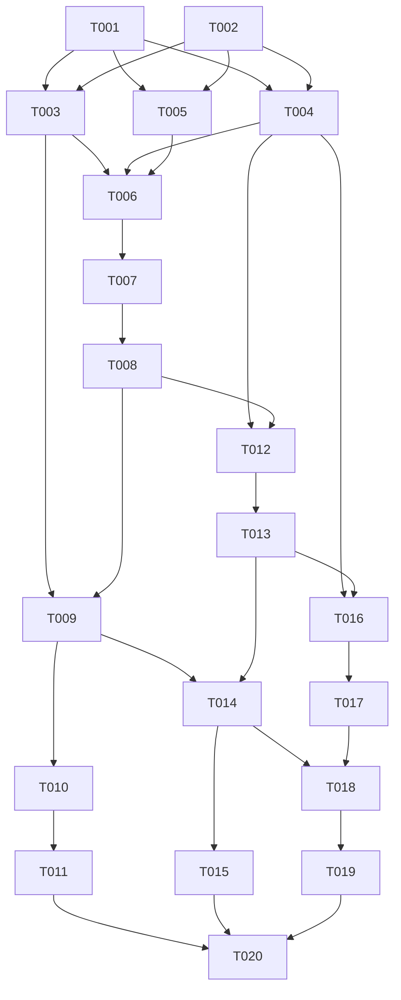

# Tasks: 008-user-profile

**Input**: Design documents from `/specs/008-user-profile/`  
**Prerequisites**: `spec.md`, `plan.md`, `specs/001-auth-identity/`  
**Target Project**: `/Users/macbookpro/Documents/Work/Prepare/PKS/pks-course-enrollment-portal`

---

## Execution Summary
- **Total Task Count**: 20
- **User Stories Covered**: US1 (View Profile & Role Badge), US2 (Update Display Name), US3 (Change Password with Verification)
- **MVP Scope**: Phase 1 through Phase 4 (US1 & US2)

---

## Phase 1: Setup & Infrastructure

**Purpose**: Set up client and server directory endpoints for user profile management.

- [ ] T001 Initialize user controller, service, and schema files in `server/src/controllers/user.controller.ts`, `server/src/services/user.service.ts`, and `server/src/schemas/user.schema.ts`
- [ ] T002 [P] Create user profile service in `client/src/services/userService.ts` and ensure profile page exists in `client/src/pages/ProfilePage.tsx`

---

## Phase 2: Foundational Prerequisites

**Purpose**: Shared types, Zod schemas, and route mounting for profile operations.

- [ ] T003 [P] Define `UserProfileDTO`, `UpdateProfilePayload`, and `ChangePasswordPayload` interfaces in `client/src/types/user.ts`
- [ ] T004 [P] Implement Zod validation schemas (`updateProfileSchema`, `changePasswordSchema`) in `server/src/schemas/user.schema.ts` ensuring name length 2-100 and newPassword $\ge 6$ chars with mismatch from current
- [ ] T005 Mount user router `/api/user` with `authenticateJWT` middleware in `server/src/routes/user.routes.ts` and register it in `server/src/routes/index.ts`

---

## Phase 3: User Story 1 — View Personal Account Details & Role Badge (Priority: P1 🎯 MVP)

**Goal**: Allow authenticated users to view their account metadata (name, email, role badge in Deep Muted Semantics, registration date in `YYYY-MM-DD`).

**Independent Test**: Call `GET /api/user/profile` with Bearer token, verify 200 OK with user profile details, and verify `/profile` page displays the role badge and registration date.

### Backend Implementation (US1)
- [ ] T006 [US1] Implement `getUserProfile` service in `server/src/services/user.service.ts` selecting `id`, `name`, `email`, `role`, and `created_at` from `prisma.user`
- [ ] T007 [US1] Implement `getProfile` controller in `server/src/controllers/user.controller.ts` returning uniform JSON envelope `{ success: true, data: user, message }`
- [ ] T008 [US1] Mount `GET /profile` in `server/src/routes/user.routes.ts`

### Frontend Implementation (US1)
- [ ] T009 [P] [US1] Implement `getProfile` API call in `client/src/services/userService.ts`
- [ ] T010 [US1] Build accessible profile overview section in `client/src/pages/ProfilePage.tsx` with container (`card-user-profile`), role badge (`badge-profile-role`: Deep Emerald for student, Deep Amber for admin), disabled email (`input-profile-email`), registration date (`text-user-created-at`), and loading skeleton (`skeleton-profile`)
- [ ] T011 [US1] Protect route `/profile` with `ProtectedRoute` in `client/src/App.tsx` and wire navigation from Header (`link-header-profile`)

---

## Phase 4: User Story 2 — Update Display Name (Priority: P1 🎯 MVP)

**Goal**: Allow users to edit and save their display name, reflecting changes immediately in the profile view and header.

**Independent Test**: Submit new name on `/profile`, verify 200 OK from `PUT /api/user/profile`, verify Sonner toast appears, and verify updated name persists.

### Backend Implementation (US2)
- [ ] T012 [US2] Implement `updateDisplayName` in `server/src/services/user.service.ts` updating only `name` and ensuring `email` and `role` are never mutated
- [ ] T013 [US2] Implement `updateProfile` controller in `server/src/controllers/user.controller.ts` returning updated user and mount `PUT /profile` with `validate(updateProfileSchema)` in `server/src/routes/user.routes.ts`

### Frontend Implementation (US2)
- [ ] T014 [P] [US2] Implement `updateProfile` API call in `client/src/services/userService.ts`
- [ ] T015 [US2] Build name update form in `client/src/pages/ProfilePage.tsx` with input (`input-profile-name`), submit button (`btn-update-name`), loading spinner `Loader2`, Sonner toast feedback (no alert), and reactive update to `AuthContext.updateUser`

---

## Phase 5: User Story 3 — Change Password with Current Password Verification (Priority: P2)

**Goal**: Enable users to change password by verifying current password with `bcrypt.compare` and hashing new password with `bcryptjs` salt factor $\ge 10$.

**Independent Test**: Submit password change with incorrect current password (verify 400 `INVALID_CURRENT_PASSWORD`), then submit valid change (verify 200 OK and subsequent login with new password).

### Backend Implementation (US3)
- [ ] T016 [US3] Implement `changePassword` service in `server/src/services/user.service.ts` supporting snake_case `current_password` and `new_password` (with camelCase alias), verifying current password with `bcrypt.compare`, hashing new password with `bcryptjs` salt 10, and updating `password_hash` in database
- [ ] T017 [US3] Implement `changePassword` controller in `server/src/controllers/user.controller.ts` returning 200 on success or 400 on invalid current password, and mount `PUT /change-password` with `validate(changePasswordSchema)` in `server/src/routes/user.routes.ts`

### Frontend Implementation (US3)
- [ ] T018 [P] [US3] Implement `changePassword` API call in `client/src/services/userService.ts`
- [ ] T019 [US3] Build password change section in `client/src/pages/ProfilePage.tsx` with inputs (`input-current-password`, `input-new-password`, `input-confirm-new-password`), submit button (`btn-change-password`), inline validation errors (`role="alert"`), input reset upon success, and Sonner toast notifications

---

## Phase 6: Polish & Cross-Cutting Concerns

**Purpose**: Accessibility checks, mobile ergonomics, theme contrast, and regression verification.

- [ ] T020 [P] Audit Profile page in `client/src/pages/ProfilePage.tsx` for mobile ergonomics (tap targets $\ge 44\text{px}$, input font size $\ge 16\text{px}$), ARIA attributes (`aria-label`, `<label htmlFor>`), and verify dual theme contrast on Deep Emerald and Deep Amber role badges (`badge-profile-role`)

---

## Dependencies & Execution Graph

